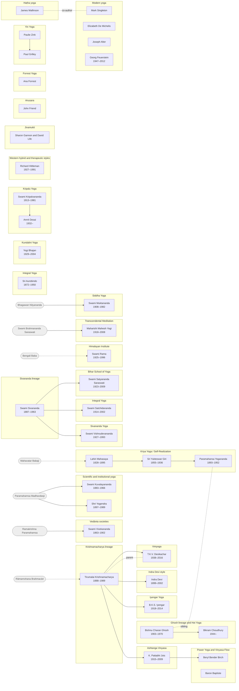
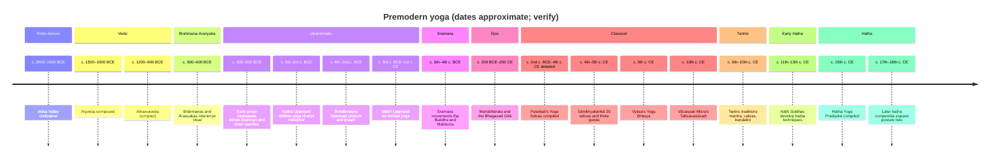
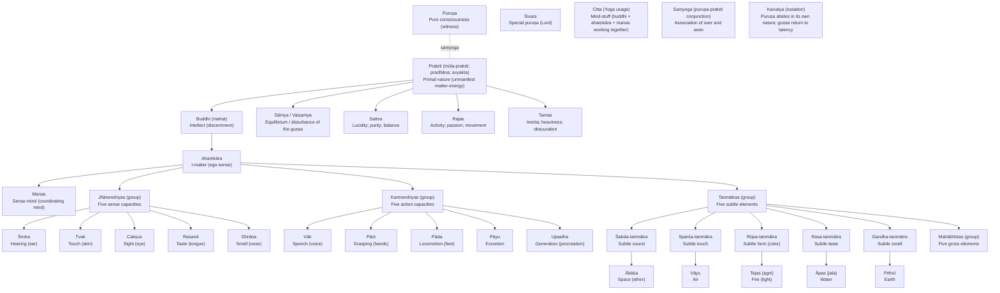
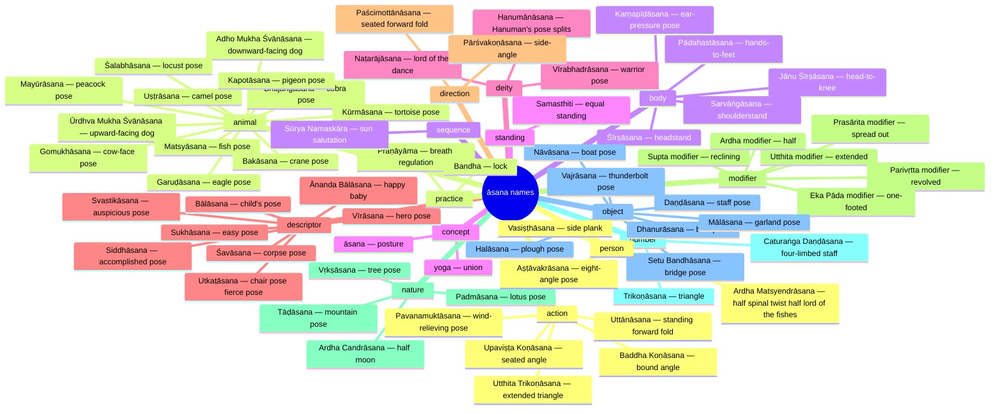

These diagrams are generated from the CSV dataset in tide (`40-projects/ytt-knowledge-graph`). The dataset was drafted by Claude from memory, so verify dates and attributions before teaching them. For the interactive version with portraits, open the [Yoga Lineage Atlas](https://claude.ai/artifact/GmnMQKiVqocJYwViegS8uK).

## Lineage tree
Solid arrows run parent → branch. Dotted arrows are a secondary influence.
```mermaid
flowchart TD
  L001["Yoga (all traditions)"]
  L002["Pre-classical (Vedic; Upaniṣadic; Gītā)"]
  L003["Classical (Sāṃkhya-Yoga / Patañjala)"]
  L004["Tantric yoga"]
  L005["Haṭha yoga (premodern)"]
  L006["Modern yoga (c. 1890–present)"]
  L007["Vedānta societies (Vivekananda)"]
  L008["Kriya Yoga / Self-Realization"]
  L009["Integral Yoga (Aurobindo)"]
  L010["Scientific and institutional yoga"]
  L011["Krishnamacharya lineage (Mysore)"]
  L012["Ashtanga Vinyasa"]
  L013["Iyengar Yoga"]
  L014["Viniyoga"]
  L015["Indra Devi style"]
  L016["Power Yoga and Vinyasa Flow"]
  L017["Sivananda lineage"]
  L018["Sivananda Yoga (Vishnudevananda)"]
  L019["Integral Yoga (Satchidananda)"]
  L020["Bihar School of Yoga (Satyananda)"]
  L021["Siddha Yoga (Muktananda)"]
  L022["Himalayan Institute (Swami Rama)"]
  L023["Kundalini Yoga (Yogi Bhajan)"]
  L024["Kripalu Yoga"]
  L025["Ghosh lineage and Hot Yoga (Bikram)"]
  L026["Transcendental Meditation"]
  L027["Western hybrid and therapeutic styles"]
  L028["Jivamukti"]
  L029["Anusara"]
  L030["Yin Yoga"]
  L031["Restorative Yoga"]
  L032["Forrest Yoga"]
  L001 --> L002
  L001 --> L003
  L001 --> L004
  L004 --> L005
  L001 --> L006
  L005 -.-> L006
  L006 --> L007
  L006 --> L008
  L006 --> L009
  L006 --> L010
  L006 --> L011
  L011 --> L012
  L011 --> L013
  L011 --> L014
  L011 --> L015
  L012 --> L016
  L006 --> L017
  L017 --> L018
  L017 --> L019
  L017 --> L020
  L006 --> L021
  L006 --> L022
  L006 --> L023
  L006 --> L024
  L006 --> L025
  L006 --> L026
  L006 --> L027
  L027 --> L028
  L012 -.-> L028
  L017 -.-> L028
  L027 --> L029
  L013 -.-> L029
  L027 --> L030
  L027 --> L031
  L013 -.-> L031
  L027 --> L032
  classDef era fill:#f4ead5,stroke:#8a6d3b
  classDef style fill:#e3eef7,stroke:#4a7aa0
  class L001,L002,L003,L004,L005,L006 era
  class L016,L028,L029,L030,L031,L032 style
```

## Who taught whom
Grouped by school. Solid arrows run teacher → student; dashed means the link is known only from traditional accounts. Grey rounded boxes are teachers outside the dataset.


## Timeline: premodern


## Timeline: modern

```mermaid
timeline
  title Modern yoga 1875–present (verify)
  section Colonial
    1875–1900 : Theosophy and Orientalism recast yoga
  section Modern
    1893–1896 : Vivekananda in Chicago; Rāja Yoga
    c. 1900–1930 : Physical culture meets yoga; modern postural yoga forms
    1918 : The Yoga Institute founded Bombay
    1920 : Yogananda arrives in the US; SRF founded
    1924 : Kaivalyadhama founded; yoga research begins
    1933–1934 : Krishnamacharya at the Mysore Palace
    1936 : Divine Life Society founded Rishikesh
    1946 : Autobiography of a Yogi published
    1947–1948 : Indra Devi in Hollywood; Jois's institute in Mysore
    1952–1954 : Menuhin brings Iyengar to the West
    1959 : First Sivananda Yoga Vedanta Centre Montréal
    1961–c. 1970 : Television yoga Hittleman; Lilias
    1966 : Light on Yoga published; Integral Yoga Institute NYC
    1967–1969 : Counterculture Beatles, Woodstock, 3HO
    1971–1975 : Institutions consolidate Himalayan Institute, Pune, Yoga Journal
    c. 1973 : Bikram's Beverly Hills studio hot yoga
    1976 : Krishnamacharya Yoga Mandiram founded Chennai
    1984–1999 : Studio-yoga boom Jivamukti, Power Yoga, Anusara
    2010s–present : Misconduct reckonings and ethics debates
    2014–2015 : International Day of Yoga proclaimed
  section Scholarship
    2004–2010 : Critical histories of modern yoga
```


## Sāṃkhya: puruṣa, prakṛti and the tattvas


## Āsana names by category

